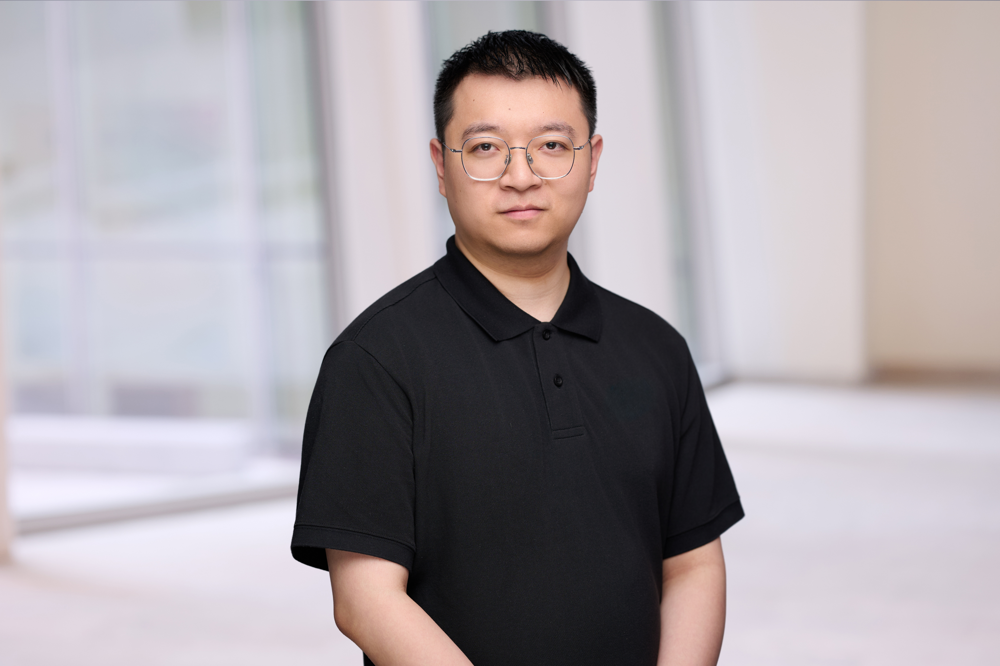

## Faculty

<table>
  <tr>
    <td style="width:160px; vertical-align:top; padding-right:1.5rem;">
      
    </td>
    <td style="vertical-align:top;">
      
<strong>Jiahao Yu</strong> 
      Principal Investigator 
      Tenure-Track Assistant Professor 
      Department of Computer Engineering 
      New York University Abu Dhabi

      

        <a href="https://hubertyoo.github.io/">Personal page</a> ·
        <a href="mailto:jy5951@nyu.edu">jy5951@nyu.edu</a> ·
        <a href="/files/CV.pdf">CV</a>
      

      
Jiahao Yu received his Ph.D. in Computer Science from Northwestern University, advised by Prof. Xinyu Xing, and his B.S. from Shanghai Jiao Tong University. His research sits at the intersection of AI and security, with a focus on large language models and reinforcement learning for program repair, vulnerability discovery, and robust LLM systems. He is a co-founder of the <a href="https://nsoc.engineering.nyu.edu/">NYU Software Supply Chain Security Operations Center (NSOC)</a>.

    </td>
  </tr>
</table>

## Students and Postdocs

<table>
  <tr>
    <td style="width:160px; vertical-align:top; padding-right:1.5rem;">
      
    </td>
    <td style="vertical-align:top;">
      
<strong><a href="https://halaali198.github.io/">Hala Ali</a></strong> 
      Postdoctoral Researcher 
      NYU Tandon School of Engineering 
      Co-mentored by Prof. Jiahao Yu and <a href="https://ssl.engineering.nyu.edu/personalpages/jcappos/">Prof. Justin Cappos</a>

      

        <a href="https://halaali198.github.io/">Personal page</a> ·
        <a href="https://scholar.google.com/citations?user=W3K5frsAAAAJ">Google Scholar</a> ·
        <a href="https://github.com/HalaAli198">GitHub</a>
      

      
Hala Ali received her Ph.D. in Computer Science from Virginia Commonwealth University in 2026. Her research spans software supply chain security, AI security, and memory forensics, including runtime detection of malicious ML models and runtime SBOM generation, and received the DFRWS USA Best Paper Award in 2025 and 2026. In the lab, she builds LLM agents that detect malicious packages on PyPI and npm.

    </td>
  </tr>
</table>

We are actively looking for Ph.D. students and postdocs. If this sounds like you, please see [Join Us](/join/).
